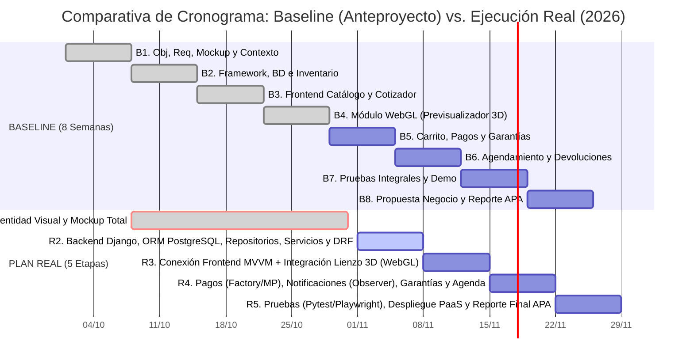

# Contexto Maestro de Ingeniería y Negocio: Plataforma E-commerce "Pastelería Ilusión"

> **Instrucción para Claude Code:** Este documento contiene los lineamientos arquitectónicos, académicos, de negocio, cronograma comparativo (Baseline vs. Real) y criterios de evaluación que rigen el desarrollo del proyecto **"Pastelería Ilusión"**. Ya cuentas con el contexto del Mockup, las reglas de negocio detalladas y las directrices visuales (`design.md`, paleta "Noche y Caramelo" y regla *antislop*). Todo el código, refactorización, pruebas y documentación técnica que generes a partir de ahora **DEBE** apegarse estrictamente a la arquitectura, estructura de carpetas, patrones de diseño y criterios de evaluación descritos en este archivo.

---

## 1. Contexto Académico e Identificación del Proyecto

* **Institución:** Universidad Nacional Autónoma de México (UNAM) - Facultad de Ingeniería.
* **Asignatura:** Negocios Electrónicos y Desarrollo Web (Semestre 2027-1, Grupo 3).
* **Profesor:** Mtro. Gerardo Gabriel Carrasco Zúñiga.
* **Equipo 02:**
  * Jaramillo Rodríguez Leslie Citlalli
  * Jiménez Ayala Yordi Josué
  * Salas Hernández Camila Alexandra
* **Hitos Cronológicos Clave:**
  * **01 de octubre de 2026:** Entrega formal del Anteproyecto y definición del *Baseline* original a 8 semanas.
  * **08 de octubre de 2026:** Inicio oficial del flujo de trabajo de ingeniería y toma de decisiones arquitectónicas (Etapa 1 Real).
  * **31 de octubre de 2026:** Cierre formal de la Etapa 1 Real (Semana intensiva de identidad visual de la pastelería, paleta "Noche y Caramelo", iconografía, reglas de negocio completas y Mockup interactivo con flujo completo).
  * **01 de noviembre de 2026 (Fecha actual):** Transición hacia el desarrollo intensivo de Backend, Base de Datos e Integración (Etapas 2 a 5 Reales).

---

## 2. Objetivos y Requerimientos Obligatorios del Sistema

### 2.1 Objetivo General
Aplicar los conceptos y conocimientos de la materia para desarrollar una aplicación web funcional orientada al comercio electrónico que digitalice las ventas, el control de inventario y la gestión de pedidos de una pastelería local.

### 2.2 Objetivos Específicos y Requerimientos Funcionales (Checklist del Profesor)
1. **Catálogo Digital e Inventario en Tiempo Real:** Implementar un catálogo digital que muestre los respectivos precios por producto o servicio y permita consultar disponibilidad para compra inmediata o apartados sin acudir al local físico.
2. **Cotización, Compra y Carrito en Línea:** Desarrollar un sistema en el que el cliente pueda cotizar, comprar y realizar el pago de uno o más pasteles/servicios en línea.
3. **Cotizador y Previsualizador Interactivo 3D (WebGL):** Diseñar un módulo interactivo utilizando WebGL (`react-three-fiber`) para previsualizar gráficos y personalizaciones de los pasteles (como las obleas y decoraciones) antes de la compra, obteniendo una cotización exacta.
4. **Sistema de Garantías Digitales (Préstamo de Bases Físicas):** Sustituir el sistema de notas físicas en papel por comprobantes digitales en PostgreSQL vinculados a la cuenta del cliente para gestionar de forma segura los depósitos cobrados por el préstamo de bases para pasteles y procesar su reembolso al devolver la base.
5. **Sistema de Agendamiento de Entregas (Anti-empalmes):** Integrar un calendario sincronizado donde el sistema proponga una fecha de entrega, o en su defecto, el cliente proponga una fecha para agendar su pedido, evitando cruces de horarios o saturación en una misma fecha.
6. **Cancelaciones y Devoluciones:** Implementar opciones claras y funcionales de cancelación o devolución para los clientes.

---

## 3. Rúbrica Oficial de Evaluación (Meta: Nivel "Excelente" 9.5 - 10)

Claude Code debe asegurarse de que cada componente técnico y documental facilite el cumplimiento del nivel máximo de la rúbrica oficial del profesor:

| Rubro | EXCELENTE (9.5 - 10) | MUY BIEN (8.5 - 9.4) | BIEN (7.5 - 8.4) | REG. (5.5 - 7.4) | Implicación en Nuestro Proyecto |
| :--- | :--- | :--- | :--- | :--- | :--- |
| **Objetivo** | Definición clara | Múltiples objetivos o ambiguos | Inviable o no factible | Sin objetivo | Alinear endpoints, vistas y flujos directamente con los 6 objetivos específicos. |
| **Def. de Producto o Servicio** | Claridad en el producto y/o servicios | Demasiados productos y/o servicios | No es claro qué producto y/o servicio | No se define prod. o servicio | Separar claramente en el dominio: 1) Catálogo estándar, 2) Personalización 3D y 3) Garantía de bases. |
| **Estrategia** | Estrategia detallada, clara y precisa | Estrategia general | Estrategia ambigua o imprecisa | Sin estrategia | Mantener modularidad estricta entre etapas iterativas y capas de software. |
| **Arquitectura** | Arquitectura diagramada y explicada | Arquitectura diagramada o explicada | Arquitectura mencionada | Sin arquitectura | Documentar con Mermaid.js y respetar Frontend (MVVM) + Backend (MVT + Servicios + Repositorios). |
| **Plan de trabajo (Baseline vs. Real)** | Plan real, retador, explicado y justificado | Plan real vs. Baseline | Plan baseline | Sin plan baseline ni real | Contrastar la tabla original de 8 semanas contra el cronograma real justificando el hito del 31 de octubre. |
| **Tecnología** | Tecnología claramente documentada y detallada | Tecnología detallada | Tecnología definida | Sin tecnología | Documentar versiones, rol y justificación de React, Tailwind, R3F/WebGL, Django, DRF, PostgreSQL y Mercado Pago. |
| **Framework** | Framework seleccionado, instalado y demostrado | Framework seleccionado y mostrado | Framework mencionado | No usó framework | Demostrar Django ("batteries included", ORM, Admin, DRF) y React funcionando en vivo. |
| **Prototipo / Mockup** | Demo funcional y presentada *(+ Pruebas como valor agregado)* | Demo presentada | Demo en diapositivas | Sin demo | Conectar el mockup de alta fidelidad al backend real e incluir suite de pruebas automatizadas (`pytest` + `Playwright`). |
| **Fuentes** | Documentación de fuentes y uso de bibliografía APA | Documentación de fuentes sin formato APA | Tabla final de bibliografía | Sin referencias | Incluir citas y referencias técnicas oficiales en formato APA 7ma edición. |

---

## 4. Plan de Trabajo: Comparativa Baseline (8 Semanas) vs. Plan Real

Uno de los rubros críticos de evaluación del profesor es **Plan de trabajo (Baseline vs. Real): *"Plan real, retador, explicado y justificado"***. A continuación se documentan ambos planes con sus fechas exactas para mantener trazabilidad total.

### 4.1 Baseline Original del Anteproyecto (8 Semanas / 8 Etapas)

El anteproyecto se entregó el **01 de octubre de 2026**, estipulando un plan base de 8 semanas lineales. A continuación se desglosa la tabla original del Anteproyecto con su correspondencia en semanas calendario (tanto desde la fecha de entrega 01/10 como desde el arranque técnico 08/10):

| Etapa / Semana (Baseline) | Fechas Calendario (Ref. Entrega 01/10) | Fechas Calendario (Ref. Arranque 08/10) | Actividad Estipulada en el Anteproyecto | Resultado Esperado (Baseline) | Estado Real al 01 de Noviembre de 2026 |
| :--- | :--- | :--- | :--- | :--- | :--- |
| **Etapa 1 (Semana 1)** | 01 oct – 07 oct 2026 | 08 oct – 14 oct 2026 | Definición de objetivos y levantamiento de requerimientos. Creación del diseño de interfaz (Mockup) y definición de la arquitectura del sistema (Diagrama de Contexto). | Objetivos, requerimientos, Mockup y Diagrama de Contexto definidos. | **COMPLETADO Y EXPANDIDO (08 oct - 31 oct):** Se profundizó en reglas de negocio, arquitectura con patrones GoF, identidad visual completa y Mockup interactivo total. |
| **Etapa 2 (Semana 2)** | 08 oct – 14 oct 2026 | 15 oct – 21 oct 2026 | Selección, instalación y justificación del framework a utilizar. Diseño de la base de datos relacional y desarrollo del módulo de gestión de usuarios e inventario en tiempo real. | Framework seleccionado e instalado. Base de datos diseñada y módulo de usuarios e inventario desarrollado. | **PARCIAL / EN CURSO:** Frameworks (Django + React) seleccionados y justificados; esquema PostgreSQL diseñado. Falta codificar modelos ORM, repositorios y endpoints de inventario. |
| **Etapa 3 (Semana 3)** | 15 oct – 21 oct 2026 | 22 oct – 28 oct 2026 | Programación del frontend para el catálogo de productos. Implementación de la vista de precios y el sistema para que el cliente pueda cotizar sus pedidos. | Catálogo funcional con precios y sistema de cotización implementado. | **ADELANTADO EN UI (Completado al 31 oct en Mockup):** Las vistas del catálogo, precios y flujo del cotizador ya están maquetadas en React/Tailwind; solo resta conectar a la API. |
| **Etapa 4 (Semana 4)** | 22 oct – 28 oct 2026 | 29 oct – 04 nov 2026 | Desarrollo e integración del módulo WebGL para la personalización y previsualización en 3D de las obleas y decoraciones en los pasteles. | Módulo WebGL funcional para previsualización 3D de pasteles. | **EN CURSO:** Flujo visual y reglas paramétricas del cotizador definidos; pendiente conectar el lienzo `react-three-fiber` con el `pricing_service.py` del backend. |
| **Etapa 5 (Semana 5)** | 29 oct – 04 nov 2026 | 05 nov – 11 nov 2026 | Integración del carrito de compras y la pasarela de pagos. Desarrollo del sistema de base de datos para registrar y vincular los importes de las bases físicas a las cuentas de los clientes. | Pasarela de pagos integrada y sistema de garantías digitales vinculado a cuentas de cliente. | **PENDIENTE (Etapa 4 Real):** UI lista en Mockup; pendiente integración de SDK Mercado Pago (`Factory Method` + `Adapter`) y `warranty_service.py`. |
| **Etapa 6 (Semana 6)** | 05 nov – 11 nov 2026 | 12 nov – 18 nov 2026 | Implementación del sistema de agendamiento de entregas (propuestas por el sistema o por el cliente) para evitar empalmes. Programación de las opciones de cancelación o devolución. | Sistema de agendamiento y lógica de cancelaciones/devoluciones funcionales. | **PENDIENTE (Etapas 2 y 4 Reales):** Reglas de negocio anti-empalmes definidas el 31 de oct; pendiente codificación transaccional en PostgreSQL y `order_observer.py`. |
| **Etapa 7 (Semana 7)** | 12 nov – 18 nov 2026 | 19 nov – 25 nov 2026 | Ejecución de pruebas integrales para asegurar el correcto flujo de compra y la gestión del inventario. Preparación del demo funcional para la presentación. | Sistema probado integralmente y demo funcional preparado. | **PENDIENTE (Etapa 5 Real):** Se enriquecerá con pruebas automatizadas en `Pytest` y `Playwright` + despliegue PaaS. |
| **Etapa 8 (Semana 8)** | 19 nov – 25 nov 2026 | 26 nov – 02 dic 2026 | Afinación de la propuesta de negocio (valor agregado). Redacción del reporte final documentando la tecnología utilizada y recopilación de fuentes bibliográficas. | Propuesta de negocio afinada, reporte final y referencias recopiladas. | **PENDIENTE (Etapa 5 Real):** Cierre documental, comparativa Baseline vs. Real y referencias APA. |

---

### 4.2 Justificación Técnica y de Negocio del Desfase (Del 08 al 31 de Octubre de 2026)

1. **¿Por qué se extendió la Etapa 1 hasta el 31 de octubre?**
   * En el *Baseline* original, la Semana 1 contemplaba únicamente un boceto rápido (Mockup básico) antes de saltar a programar la base de datos en la Semana 2.
   * Sin embargo, al iniciar la arquitectura el **08 de octubre**, el equipo detectó que los flujos de **cotización 3D**, **préstamo/garantía de bases físicas** y **agendamiento sin empalmes** tenían reglas de negocio complejas que, de no definirse exhaustivamente antes de programar la base de datos, provocarían migraciones rotas y retrabajo severo.
   * Además, durante la última semana de octubre (**cerrando el 31 de octubre de 2026**), el equipo realizó un sprint de **Identidad Visual e Ingeniería de UI**: se definió la marca de la pastelería, iconografía personalizada, la paleta estricta **"Noche y Caramelo"**, el documento rector `design.md` (con la regla *antislop*) y se construyó el **Mockup completo con todo su flujo interactivo en código**.
2. **Impacto Positivo (Adelanto de la Semana 3 del Baseline):**
   * Aunque en calendario parece haber un atraso respecto a la Base de Datos (Semana 2 del Baseline), en realidad **el trabajo de interfaz de la Semana 3 (Frontend de Catálogo y Cotizador) y el diseño de vistas de las Semanas 5 y 6 ya fueron absorbidos y completados** dentro del Mockup de alta fidelidad terminado el 31 de octubre.
   * Gracias a esto, a partir del **01 de noviembre**, el desarrollo Backend en Django (Etapa 2 Real) cuenta con contratos de datos 100% claros y vistas listas para conectarse.

---

### 4.3 Plan de Trabajo Real Reestructurado (Consolidado en 5 Etapas de Ingeniería)

Para optimizar los tiempos de entrega en noviembre de 2026, las 8 etapas originales se consolidaron en **5 Etapas de Ingeniería**:

* **Etapa 1: Levantamiento, Identidad Visual y Diseño (COMPLETADA: 08 de Octubre – 31 de Octubre de 2026)**
  * **Objetivo 1.1:** Definición de objetivos, levantamiento de requerimientos y reglas de negocio (cotización, inventario, agenda y garantías).
  * **Objetivo 1.2:** Identidad visual ("Noche y Caramelo", `design.md`, regla *antislop*) y maquetación del Mockup estático completo en React y Tailwind CSS con datos de prueba (absorbiendo el trabajo visual de las Semanas 1 y 3 del Baseline).
  * **Objetivo 1.3:** Diseño de la arquitectura dividida (React/MVVM y Django/MVT + Servicios/Repositorios), selección de patrones GoF y Diagrama de Contexto.

* **Etapa 2: Desarrollo Backend y Base de Datos (EN CURSO: Semana del 01 al 07 de Noviembre de 2026)** *(Equivale a Semana 2 + BD de Semanas 5 y 6 del Baseline)*
  * Configuración del entorno en Django y conexión con PostgreSQL.
  * Creación de modelos ORM (`Usuarios`, `Productos`, `Inventario`, `Pedidos`, `Cotizaciones3D`, `GarantiasBases`, `AgendaEntregas`).
  * Implementación de la capa de Repositorios (`product_repo.py`, `order_repo.py`) y la capa de Servicios (`pricing_service.py`, `warranty_service.py`).
  * Exposición de endpoints mediante Django REST Framework (DRF) bajo `/api/v1/`, documentación automática con Swagger (`drf-spectacular`) y configuración de Django Admin.

* **Etapa 3: Desarrollo Frontend Dinámico e Integración 3D (Semana del 08 al 14 de Noviembre de 2026)** *(Equivale a conexión de Semana 3 + Semana 4 del Baseline)*
  * Transición del Mockup estático a arquitectura MVVM en React conectada a la API REST de Django.
  * Implementación y refinamiento del lienzo interactivo con `react-three-fiber` (WebGL) para la configuración paramétrica de pasteles y obleas.
  * Conexión del estado del configurador 3D con el generador de cotizaciones dinámicas hacia el backend (`pricing_service.py` con patrón *Strategy*).

* **Etapa 4: Pasarela de Pagos, Garantías y Notificaciones (Semana del 15 al 21 de Noviembre de 2026)** *(Equivale a Semanas 5 y 6 del Baseline)*
  * Codificación del patrón *Factory Method* + *Adapter* integrando el SDK de Mercado Pago en entorno Sandbox.
  * Codificación del patrón *Observer* (`order_observer.py`) para disparar eventos y notificaciones en cada cambio de estado del pedido.
  * Implementación del flujo transaccional de retención/liberación de depósitos para el sistema de garantías de bases físicas, agendamiento sin empalmes y opciones de cancelación/devolución.

* **Etapa 5: Pruebas Automatizadas, Despliegue (PaaS) y Cierre APA (Semana del 22 al 28 de Noviembre de 2026)** *(Equivale a Semanas 7 y 8 del Baseline)*
  * Pruebas unitarias en backend con `Pytest` y pruebas E2E de interfaz con `Playwright` (flujo de compra estándar, cotización 3D y registro de garantía).
  * Configuración de variables de entorno, servidor de archivos estáticos y despliegue en producción (PaaS) para frontend, backend y base de datos PostgreSQL.
  * Preparación de la demo funcional y entrega del reporte final con comparativa Baseline vs. Real y referencias en formato APA.

### 4.4 Diagrama de Gantt Comparativo (Mermaid.js): Baseline vs. Real



---

## 5. Arquitectura del Sistema y Estructura de Carpetas

### 5.1 Stack Tecnológico
* **Frontend:** React.js + Tailwind CSS + `react-three-fiber` (Arquitectura **MVVM**: *Model* = servicios de API/datos; *ViewModel* = Custom Hooks que gestionan el estado observable y lógica de vista; *View* = Componentes JSX declarativos respetando `design.md` y la paleta "Noche y Caramelo").
* **Backend:** Python + Django + Django REST Framework (Arquitectura **MVT extendida con Capas de Servicios y Repositorios**).
* **Base de Datos:** PostgreSQL.
* **Servicios Externos:** API de Mercado Pago (Sandbox).

### 5.2 Diagrama de Contexto (Mermaid.js)

```mermaid
graph TD
    Cliente([Cliente / Usuario])
    Admin([Administrador])

    subgraph "Plataforma E-commerce Pastelería Ilusión"
        UI[Frontend: React.js + MVVM\n- Vistas de Catálogo y Agendamiento\n- Cotizador 3D WebGL]
        API[Backend: Django REST Framework\n- Controladores API / Serializers\n- Capa de Servicios y Patrones GoF\n- Capa de Repositorios]
        DB[(PostgreSQL\n- Inventario y Pedidos\n- Garantías Digitales y Calendario)]
    end

    MP[Pasarela Externa\nMercado Pago Sandbox]

    Cliente -->|Solicita vistas, configura 3D, agenda y ordena| UI
    Admin -->|Gestiona inventario, estados y garantías| API
    UI <-->|Peticiones HTTP / JSON REST v1| API
    API <-->|Consultas y Transacciones SQL ACID| DB
    API <-->|Procesamiento de cobros vía Adapter/Factory| MP
```



### 5.3 Estructura Obligatoria del Backend (`core_pasteleria`)

Claude Code **DEBE** implementar exactamente esta estructura de paquetes y módulos en la aplicación principal de Django:

```text
core_pasteleria/
├── models.py               # Definición de tablas y relaciones (ORM PostgreSQL)
├── api/                    # CAPA DE CONTROLADORES (Presentación / Entrada REST)
│   ├── views.py            # Recibe requests HTTP, invoca servicios y retorna responses
│   ├── serializers.py      # Validación y transformación de datos JSON (DTOs)
│   └── urls.py             # Enrutamiento de endpoints (Front Controller de la app)
├── services/               # CAPA DE SERVICIOS (Lógica de Negocio y Patrones GoF)
│   ├── pricing_service.py  # Cálculo de costos del cotizador 3D (Patrón Strategy)
│   ├── warranty_service.py # Reglas de préstamo, retención y devolución de bases
│   ├── payments/
│   │   └── payment_factory.py  # Patrón Factory Method + Adapter (Mercado Pago / Otros)
│   └── orders/
│       └── order_observer.py   # Patrón Observer (Cambio de estados, stock y alertas)
└── repositories/           # CAPA DE ACCESO A DATOS (Aislamiento del ORM)
    ├── product_repo.py     # Consultas de catálogo y stock en tiempo real
    └── order_repo.py       # Consultas transaccionales de pedidos, agenda y garantías
```

---

## 6. Reglas Estrictas de Implementación de Patrones de Diseño (Tema 3 de Clase)

De acuerdo con el material académico del profesor (*Tema 3: Patrones de Diseño*), Claude Code debe implementar los patrones evitando caer en los **Antipatrones** señalados en la diapositiva 45 de clase (*Patrón Cosmético*, *Objeto Dios*, *Estado Global* y *Sobreingeniería*):

### 6.1 Factory Method (`services/payments/payment_factory.py`)
* **Propósito:** Instanciar el procesador de pagos (`MercadoPagoProcessor`, `TransferProcessor`, etc.) sin acoplar el servicio de checkout a clases concretas.
* **REGLA CRÍTICA ANTI-PATRÓN COSMÉTICO:** En la diapositiva 45 del Tema 3, el profesor señala explícitamente como antipatrón: *"Nombrar 'Factory' a una función que hace `if/elif` no aporta las ventajas del patrón"*. Por lo tanto, **queda estrictamente prohibido usar bloques `if/elif/else` para instanciar pasarelas**.
* **Implementación Requerida:** Definir una clase abstracta base (`PagoBase(ABC)`) con el método `cobrar(monto, payload)` y utilizar un **diccionario de registro polimórfico** (`REGISTRO_PASARELAS = {'mercadopago': MercadoPagoPayment, ...}`) con una función o método de fábrica `crear_procesador_pago(tipo)` que busque y retorne la instancia desde el registro (tal como enseña el profesor en la diapositiva 18 del Tema 3).

### 6.2 Strategy (`services/pricing_service.py`)
* **Propósito:** Calcular dinámicamente el precio del pastel en el cotizador 3D y aplicar reglas de negocio o descuentos de temporada sin cadenas `if/elif`.
* **Implementación Requerida:** Implementar estrategias intercambiables en tiempo de ejecución (clases o funciones de primer orden en Python inyectadas en el cotizador, según la diapositiva 21 del Tema 3) para evaluar el precio base por pisos/tamaño, recargo por oblea personalizada WebGL, rellenos especiales y descuentos promocionales.

### 6.3 Observer (`services/orders/order_observer.py`)
* **Propósito:** Notificar automáticamente a múltiples módulos interesados cada vez que un pedido cambia de estado (ej. `PAGADO`, `EN_PREPARACION`, `ENTREGADO`, `CANCELADO`, `BASE_DEVUELTA`).
* **Implementación Requerida:** El emisor (`OrderSubject`) mantiene una colección de observadores suscritos (`suscribir(observador)`) y los ejecuta desacopladamente al actualizar un pedido (diapositiva 24 del Tema 3):
  1. `NotificacionClienteObserver`: Registra/envía alerta de cambio de estado o confirmación de agenda.
  2. `InventarioObserver`: Descuenta stock al confirmar pago o lo reintegra en caso de cancelación.
  3. `GarantiaBaseObserver`: Activa el saldo retenido de la base física al entregar el pedido o libera el reembolso cuando el cliente devuelve la base en pastelería.

### 6.4 Repository Pattern (`repositories/product_repo.py` y `order_repo.py`)
* **Propósito:** Aislar las consultas al ORM de Django (`models.objects...`) dentro de una capa de acceso a datos sustituible (diapositiva 42 del Tema 3).
* **Implementación Requerida:** `api/views.py` solo coordina HTTP y llama a `services/`. Los módulos en `services/` aplican las reglas de negocio y llaman a `repositories/`. Esto permite inyectar un `RepoMemoria` en las pruebas unitarias sin tocar PostgreSQL si se desea probar lógica pura en milisegundos.

---

## 7. Sugerencias Estratégicas de los Temas 3 y 4 (Valor Agregado para el 10)

Con base en las presentaciones completas de **Tema 3 (Patrones de Diseño)** y **Tema 4 (Herramientas de Desarrollo, Pruebas y APIs)** vistas recientemente en clase, se deben incorporar estos elementos de alto impacto académico:

### 7.1 Patrones Adicionales y Buenas Prácticas de API REST (Tema 3.2 y Tema 4.2)
1. **Patrón Adapter para el SDK de Mercado Pago (`services/payments/`):**
   * En las diapositivas 29 a 31 del Tema 3, el profesor explica que *Adapter* sirve para *"integrar APIs externas sin contaminar el dominio"* y menciona explícitamente a **Mercado Pago** en la diapositiva 30.
   * *Acción:* Implementar `MercadoPagoAdapter` para envolver la librería externa `mercadopago` y traducir sus respuestas JSON al formato estándar interno de `core_pasteleria`.
2. **Patrón Decorator (`services/`):**
   * En la diapositiva 27 del Tema 3, el profesor muestra un decorador `@medir` con `functools.wraps` para medir el tiempo de ejecución y hacer logging sin ensuciar la función de negocio.
   * *Acción:* Crear un decorador `@auditar_operacion` (que mida tiempo en milisegundos y registre en el logger Singleton de Django) aplicado sobre el cálculo de cotización 3D y el procesamiento del pago.
3. **Estándares de API REST (Diapositiva 43 del Tema 3 y Diapositivas 94-100 del Tema 4):**
   * **Versionado de URL:** Exponer todas las rutas bajo `/api/v1/` (ej. `/api/v1/productos/`, `/api/v1/cotizar-3d/`, `/api/v1/pedidos/`, `/api/v1/garantias/`).
   * **Idempotencia en Pagos:** En el endpoint de pago/checkout, leer el encabezado HTTP `Idempotency-Key` para impedir cobros o pedidos duplicados si el usuario hace doble clic o reintenta la petición (mencionado explícitamente en la diapositiva 43 del Tema 3).
   * **DTOs / Serializers:** Jamás retornar instancias crudas del modelo; validar entradas y transformar salidas estrictamente mediante `api/serializers.py`.
   * **Autenticación JWT y Rate Limiting:** Configurar JWT (`SimpleJWT`) para vincular pedidos y garantías a la cuenta del cliente, además de paginación y límite de tasa (*throttling*) en DRF.

### 7.2 Contratos Claros con OpenAPI / Swagger (Tema 4.2 - Diapositivas 95 y 108)
* El profesor destaca el diseño y documentación interactiva de APIs con **OpenAPI y Swagger**.
* *Acción:* Integrar `drf-spectacular` para generar el contrato OpenAPI 3.0 y habilitar la interfaz interactiva en `/api/v1/docs/` (Swagger UI), permitiendo probar los endpoints en vivo durante la presentación final.

### 7.3 Suite de Pruebas Automatizadas (Tema 4.1.2 - Requisito de "Valor Agregado")
En el PDF de lineamientos del proyecto, el profesor pide explícitamente **"Demo con pruebas (valor agregado)"**, y en el Tema 4 destaca dos herramientas específicas para nuestro stack:
1. **Pruebas Unitarias y de Integración en Python con `Pytest` (Diapositiva 52 del Tema 4):**
   * Configurar `pytest` y `pytest-django` para probar aisladamente:
     * Cálculo dinámico del cotizador 3D con distintas estrategias (`Strategy`).
     * Resolución polimórfica de pasarelas de pago sin `if/elif` (`Factory Method` + `Adapter`).
     * Disparo de eventos de inventario, correo y garantía al cambiar el estado del pedido (`Observer`).
     * Validación de bloqueos de horario en el agendamiento de entregas (evitando empalmes) y cálculo de retención/reembolso de bases físicas.
2. **Pruebas End-to-End (E2E) en Navegador con `Playwright` (Diapositivas 56-57 del Tema 4):**
   * En la diapositiva 56 del Tema 4, el profesor pone como caso ejemplar de **Playwright**: *"Ejemplo: agregar al carrito y validar el total"*.
   * *Acción:* Crear una prueba automatizada E2E con Playwright que simule al cliente abriendo la pastelería, personalizando su pastel/oblea, agregándolo al carrito con una base física en préstamo, seleccionando fecha de entrega y validando con aserciones que el total desglose correctamente el precio del pastel más el depósito de garantía.