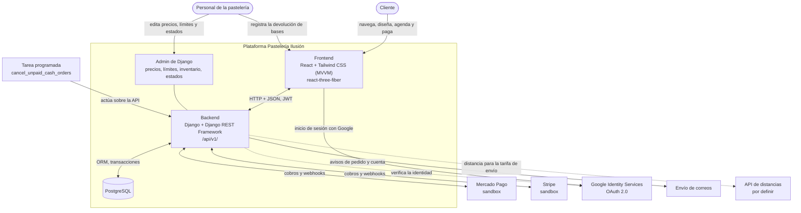
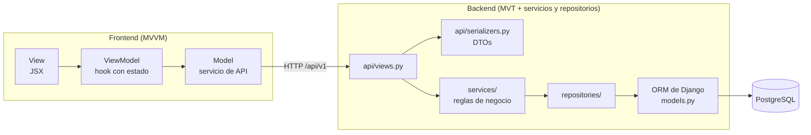
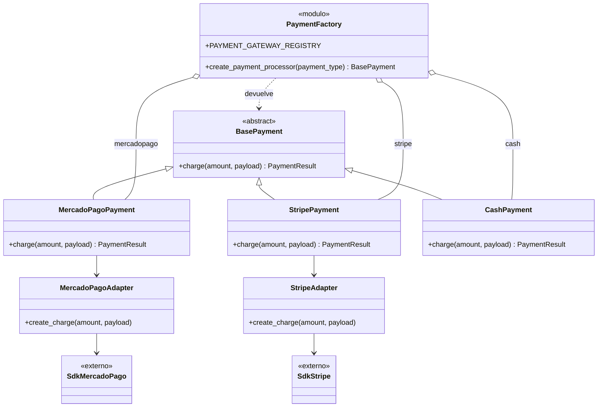
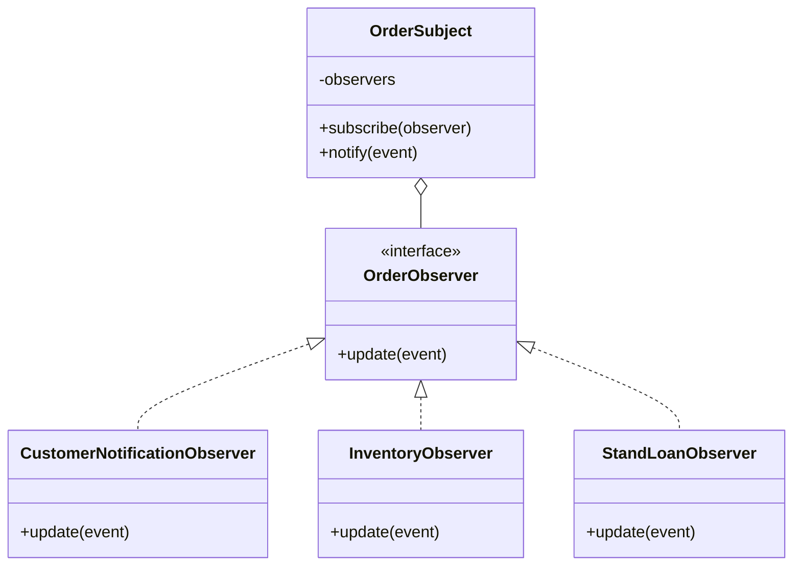
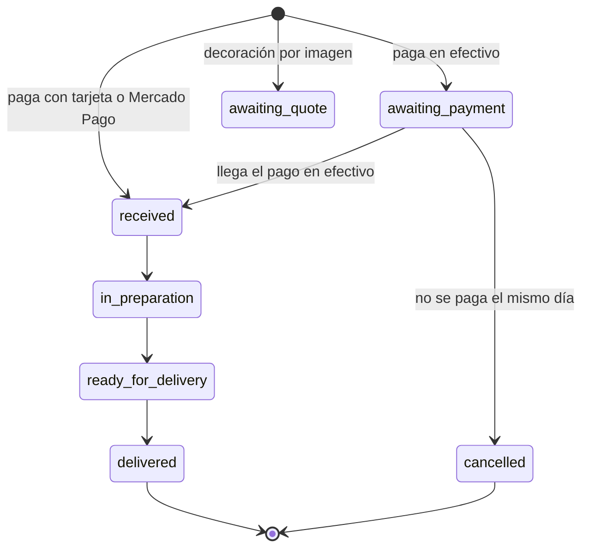
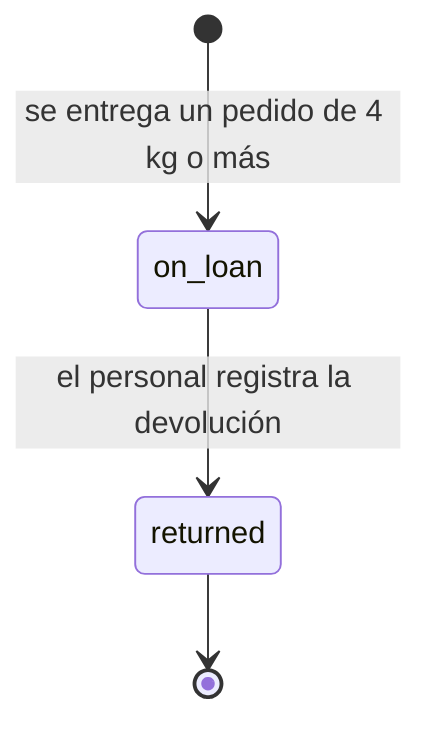

# Arquitectura

El sitio se divide en un frontend React con MVVM y un backend Django con MVT extendido por capas de servicios y repositorios. Los dos hablan por una API REST versionada en `/api/v1/`. Los nombres de clases, módulos y rutas de este documento son el diseño previsto: el código está en el esqueleto y los nombres finales se fijan en la Etapa 2.

## Contenido

- [Diagrama de contexto](#diagrama-de-contexto)
- [Capas de una petición](#capas-de-una-petición)
- [Frontend: MVVM](#frontend-mvvm)
- [Estructura del backend](#estructura-del-backend)
- [Reglas de capas](#reglas-de-capas)
- [Patrones de diseño](#patrones-de-diseño)
- [Estados del pedido y de la base](#estados-del-pedido-y-de-la-base)
- [Estándares de la API](#estándares-de-la-api)
- [Seguridad](#seguridad)
- [Entidades previstas](#entidades-previstas)
- [Ver también](#ver-también)

## Diagrama de contexto



Notas del diagrama:

- El efectivo en la pastelería no usa un servicio externo: deja el pedido apartado.
- El personal registra "Base devuelta" desde la página de verificación de la nota (`/nota/:token`) con sesión iniciada ([`../reglas-de-negocio.md`](../reglas-de-negocio.md), sección 11).
- La API de distancias sigue sin elegir. Las reglas sugieren una API de rutas como Google Distance Matrix ([`../reglas-de-negocio.md`](../reglas-de-negocio.md), sección 8).
- El proveedor de correo tampoco está definido.

## Capas de una petición



La respuesta recorre el camino inverso. La vista del backend valida con el serializador, delega en un servicio y devuelve un DTO, nunca una instancia cruda del modelo.

## Frontend: MVVM

La vista no contiene lógica de negocio. El view-model guarda el estado y llama a la API. El modelo encapsula el acceso a datos.

| Carpeta | Capa | Contenido previsto |
| --- | --- | --- |
| `frontend/src/models/` | Model | Servicios de API y tipos de datos |
| `frontend/src/viewmodels/` | ViewModel | Hooks personalizados con el estado observable y la lógica de la vista |
| `frontend/src/views/` | View | Pantallas en JSX declarativo, una por ruta de [`../mapa-de-vistas.md`](../mapa-de-vistas.md) |
| `frontend/src/components/` | View (piezas) | Componentes base del libro de marca: botones, campos, tarjetas, opciones elegibles, bordes de duya, perlas de avance, esqueletos |
| `frontend/src/three/` | View (3D) | Escena de `react-three-fiber` que recibe sus datos del view-model |
| `frontend/e2e/` | Pruebas | Pruebas de extremo a extremo con Playwright ([`pruebas.md`](pruebas.md)) |

Hoy `frontend/src/` tiene `App.tsx`, `main.tsx`, `index.css`, `views/Home.tsx` (componente `Home`) y `views/NotFound.tsx` (componente `NotFound`). Las carpetas `models/`, `viewmodels/`, `components/` y `three/` siguen vacías. El 3D no se anuncia en títulos ni botones de la interfaz ([`../../AGENTS.md`](../../AGENTS.md#reglas-que-no-se-negocian)).

## Estructura del backend

Esta es la estructura obligatoria de la aplicación principal de Django. El esqueleto ya existe en `backend/core_pasteleria/`, con un docstring por archivo.

```text
core_pasteleria/
├── models.py               # Definición de tablas y relaciones (ORM PostgreSQL)
├── api/                    # CAPA DE CONTROLADORES (Presentación / Entrada REST)
│   ├── views.py            # Recibe requests HTTP, invoca servicios y retorna responses
│   ├── serializers.py      # Validación y transformación de datos JSON (DTOs)
│   └── urls.py             # Enrutamiento de endpoints (Front Controller de la app)
├── services/               # CAPA DE SERVICIOS (Lógica de Negocio y Patrones GoF)
│   ├── pricing_service.py  # Cálculo de costos del cotizador 3D (Patrón Strategy)
│   ├── warranty_service.py # Reglas de préstamo, retención y devolución de bases
│   ├── payments/
│   │   └── payment_factory.py  # Patrón Factory Method + Adapter (Mercado Pago / Otros)
│   └── orders/
│       └── order_observer.py   # Patrón Observer (Cambio de estados, stock y alertas)
└── repositories/           # CAPA DE ACCESO A DATOS (Aislamiento del ORM)
    ├── product_repo.py     # Consultas de catálogo y stock en tiempo real
    └── order_repo.py       # Consultas transaccionales de pedidos, agenda y garantías
```

Los nombres de archivo y sufijos técnicos (`pricing_service.py`, `product_repo.py`) van en inglés porque así lo exige la especificación de arquitectura del proyecto. Los identificadores del dominio van en inglés desde D29 (`BasePayment`, `charge`, `create_payment_processor`, `PAYMENT_GATEWAY_REGISTRY`). Los comentarios y docstrings siguen en español.

## Reglas de capas

| Capa | Hace | No hace |
| --- | --- | --- |
| `api/views.py` | Coordina HTTP: recibe la petición, invoca un servicio, devuelve la respuesta | Reglas de negocio ni consultas al ORM |
| `api/serializers.py` | Valida entradas y transforma salidas (DTOs) | Devolver instancias crudas del modelo |
| `services/` | Aplica las reglas de negocio y llama a `repositories/` | Escribir `models.objects...` |
| `repositories/` | Aísla las consultas al ORM de Django | Reglas de negocio |
| `models.py` | Declara tablas y relaciones | Lógica de precios, pagos o estados |

Los precios y los límites viven en la base de datos, no en el código: la pastelería los cambia desde el admin sin un despliegue ([`../../AGENTS.md`](../../AGENTS.md#reglas-que-no-se-negocian), regla 2). Los fragmentos de código de [`../reglas-de-negocio.md`](../reglas-de-negocio.md) son referencia de la lógica, no de dónde se guardan los valores.

## Patrones de diseño

El material del Tema 3 (Patrones de diseño) del profesor marca cuatro antipatrones en la diapositiva 45: patrón cosmético, objeto Dios, estado global y sobreingeniería. Cada patrón de esta tabla se implementa de forma que evite el que le corresponde. Los números de diapositiva vienen de las notas del equipo y no se contrastaron con el material de clase.

| Patrón | Propósito | Archivo | Implementación exigida | Antipatrón que evita |
| --- | --- | --- | --- | --- |
| Factory Method | Crear el procesador de pago sin acoplar el checkout a clases concretas | `services/payments/payment_factory.py` | Clase abstracta `BasePayment(ABC)` con `charge(amount, payload)`, diccionario `PAYMENT_GATEWAY_REGISTRY` y función `create_payment_processor(payment_type)` que busca en el registro (diapositiva 18). Prohibido instanciar con `if/elif/else` | Patrón cosmético: la diapositiva 45 dice que nombrar "Factory" a una función con `if/elif` no aporta las ventajas del patrón |
| Adapter | Integrar los SDK externos sin contaminar el dominio | `services/payments/` | `MercadoPagoAdapter` envuelve la biblioteca `mercadopago` y traduce sus respuestas al formato interno; el de Stripe sigue el mismo molde (diapositivas 29 a 31; Mercado Pago se menciona en la 30) | Acoplar el dominio a la forma de respuesta de un proveedor |
| Strategy | Calcular el precio con reglas intercambiables | `services/pricing_service.py` | Estrategias en tiempo de ejecución (clases o funciones de primer orden) para pan (incremento por kilo o precio completo de Choco-pingüino y Red velvet), relleno por tipo y base, sabor especial, combinado, oblea y decoraciones fijas (precio PENDIENTE) (diapositiva 21). La pastelería no ha definido descuentos y no se inventan (D17); el diseño admite agregar una estrategia si los define | Cadenas `if/elif` en el cálculo; patrón cosmético |
| Observer | Notificar los eventos del pedido (cambio de estado y base devuelta) | `services/orders/order_observer.py` | `OrderSubject` mantiene los observadores, con `subscribe(observer)`, y les notifica eventos con `notify(event)` de forma desacoplada (diapositiva 24); ver [Observer de eventos del pedido](#observer-de-eventos-del-pedido) | Objeto Dios: un servicio de pedidos que también descuenta stock, envía avisos y activa garantías |
| Repository | Aislar el ORM detrás de una capa sustituible | `repositories/product_repo.py`, `repositories/order_repo.py` | `views` solo coordina HTTP, `services` aplica reglas y llama a `repositories` (diapositiva 42). Permite inyectar un `RepoMemoria` en las pruebas | Acceso al ORM disperso por toda la aplicación |
| Decorator | Medir y registrar sin ensuciar la función de negocio | `services/` (archivo por definir en la Etapa 2) | `@audit_operation` con `functools.wraps`, que mide milisegundos y escribe en el logger de Django; se aplica al cálculo del precio (`pricing_service`) y al cobro (`BasePayment.charge`) (diapositiva 27). Registra nombre, duración, id del pedido y resultado; nunca argumentos, payloads, tokens ni datos personales | Mezclar logging y métricas con la lógica de negocio |

Para evitar la sobreingeniería, el proyecto usa solo estos patrones. `PAYMENT_GATEWAY_REGISTRY` es una constante que no se modifica en ejecución, de modo que no funciona como estado global.

### Fábrica de pagos

El registro admite `mercadopago`, `stripe` y `cash` (efectivo). Agregar una pasarela es agregar una clase y una entrada del registro, sin tocar `create_payment_processor`.



`PaymentResult` es el formato interno estándar de respuesta; su forma exacta se define en la Etapa 4. `CashPayment` no necesita adaptador: no hay SDK, y su resultado deja el pedido en estado `awaiting_payment`.

### Observer de eventos del pedido

`OrderSubject` notifica eventos, no solo estados. Hay dos: "estado cambiado" y "base devuelta". Los estados del pedido siguen siendo los de las reglas, sección 12 (D13).



| Observador | Responsabilidad |
| --- | --- |
| `CustomerNotificationObserver` | Registra o envía el aviso de cada cambio de estado y de la confirmación de agenda |
| `InventoryObserver` | Descuenta las existencias de vitrina cuando el pedido entra en `awaiting_payment` o `received` (lo que ocurra primero) y las reintegra al entrar en `cancelled`. Así no se vende dos veces una pieza apartada en efectivo. Los pedidos personalizados no descuentan vitrina (D14) |
| `StandLoanObserver` | Al entrar el pedido en `delivered`, crea la base `on_loan` con fecha límite igual a la entrega más 15 días y retiene el depósito. Con el evento "base devuelta", que emite `warranty_service` cuando el personal la registra en `/nota/:token`, marca la base `returned` y el depósito como reembolsado |

## Estados del pedido y de la base

Los estados son los de [`../reglas-de-negocio.md`](../reglas-de-negocio.md), sección 12.



Los códigos y sus etiquetas en español están en [`../reglas-de-negocio.md`](../reglas-de-negocio.md), sección 12.

El efectivo apartado debe pagarse el mismo día antes de las 22:30; si no, el pedido se cancela. Lo que las reglas no definen y se resuelve en la Etapa 2:

- A qué estado sale `awaiting_quote` cuando la pastelería da el precio (pregunta abierta, [`../reglas-de-negocio.md`](../reglas-de-negocio.md), sección 14).
- Qué otras cancelaciones existen además de la del efectivo no recibido. La política de cambios y cancelaciones está pendiente ([`../reglas-de-negocio.md`](../reglas-de-negocio.md), sección 14).

El envío de referencia tiene su propio seguimiento: `in_review` → `quote_ready` → (el cliente acepta y paga) → pedido normal.

La base se sigue aparte. La fecha límite de devolución es la fecha de entrega más 15 días.



Al pasar a `returned`, el depósito queda marcado como reembolsado. Las reglas no definen qué pasa si la base no se devuelve a tiempo ni si regresa dañada (pendiente, sección 14).

## Estándares de la API

| Estándar | Detalle |
| --- | --- |
| Versionado | Todas las rutas bajo `/api/v1/`. Ejemplos de rutas previstas: `/api/v1/products/`, `/api/v1/cake-designs/`, `/api/v1/orders/` y `/api/v1/stand-loans/`; las rutas finales se fijan en la Etapa 2 |
| Idempotencia | El endpoint de pago lee el encabezado `Idempotency-Key` para impedir cobros o pedidos duplicados por doble clic o reintento (diapositiva 43 del Tema 3). Los webhooks de pago también son idempotentes |
| DTOs | Las entradas se validan y las salidas se transforman en `api/serializers.py`; nunca se devuelve una instancia cruda del modelo |
| Autenticación | JWT con SimpleJWT, que liga pedidos y garantías a la cuenta del cliente |
| Paginación | Paginación de DRF en los listados |
| Límite de tasa | Throttling de DRF |
| Contrato | `drf-spectacular` genera el contrato OpenAPI 3 y publica Swagger UI en `/api/v1/docs/` |

Las diapositivas 94 a 100 y 108 del Tema 4 son la referencia de clase para el diseño y la documentación de la API. Como las demás citas, no se contrastaron con el material.

## Seguridad

El detalle está en [`../../backend/AGENTS.md`](../../backend/AGENTS.md). Resumen de lo exigido:

- Los webhooks de pago verifican la firma, y el monto lo calcula el servidor, nunca el cliente.
- Los datos de tarjeta solo pasan por los componentes de Stripe y Mercado Pago.
- Cada recurso se autoriza por su dueño; pedir un recurso ajeno devuelve 404.
- Sesión (D15): el access token JWT dura de 5 a 15 minutos y vive solo en memoria del frontend. El refresh va en una cookie HttpOnly, Secure y SameSite=Lax, con rotación y lista negra; exige CSRF. CORS usa orígenes explícitos tomados del entorno.
- El backend verifica el ID token de Google.
- Las subidas se validan por contenido, se guardan con nombre aleatorio y solo las sirve a su dueño y al personal.
- El token de la nota sale de `secrets.token_urlsafe(32)`, y solo el personal con permiso puede registrar "Base devuelta".
- El efectivo pasa a `received` solo cuando el personal con permiso registra el cobro; los pagos en línea, solo por webhook verificado.
- Los serializadores de cliente dejan `status`, `refunded`, depósitos y montos de solo lectura, para evitar la asignación masiva.
- El frontend y la API comparten sitio (mismo dominio propio o mismo origen) para que la cookie de refresh `SameSite=Lax` funcione. Esto condiciona la elección de la PaaS.
- El throttling se configura por alcance.
- `DEBUG` va apagado en producción y los secretos no tienen valor por defecto.

## Entidades previstas

Estas son las entidades previstas desde el anteproyecto. Los nombres finales de modelos y campos se fijan en la Etapa 2.

| Entidad | Para qué sirve | Reglas |
| --- | --- | --- |
| `User` | Cuenta del cliente (Google o correo y contraseña) y personal | Sin sección propia; la sección 11 describe el rol del personal |
| `Product` | Catálogo con precios fijos, vitrina y rebanadas | Sección 2 |
| `Inventory` | Existencias de vitrina y disponibilidad de pan para pedidos del mismo día | Secciones 1 y 2 |
| `Order` y `OrderItem` | Pedidos, sus partidas, pagos y estados | Secciones 10 y 12 |
| `CakeDesign` | Configuración guardada de "Diseña tu pastel" y su precio | Secciones 3 a 6 |
| `ReferenceRequest` | Envío de referencia (hasta 3 imágenes) y su seguimiento (`in_review`, `quote_ready`) | Sección 9 |
| `Quote` | Cotización que la pastelería fija a un envío de referencia | Sección 9 |
| `CakeStand` y `StandLoan` | Base física (`CakeStand`) y su préstamo con depósito, fecha límite y devolución (`StandLoan`) | Secciones 7 y 11 |
| `DeliverySlot` | Lapsos de 30 min con máximo 3 pedidos activos | Sección 1 |

Las secciones son las de [`../reglas-de-negocio.md`](../reglas-de-negocio.md). Los precios y los límites configurables (kilos mínimos, depósitos, tarifas) también necesitan tablas en la base de datos; su diseño queda para la Etapa 2.

La palabra "cotización" nombra solo el envío de referencia (`Quote`). El diseño de "Diseña tu pastel" es `CakeDesign` (D29).

## Ver también

- [Objetivos y definición del producto](objetivos.md)
- [Tecnologías](tecnologias.md)
- [Pruebas](pruebas.md)
- [Decisiones](decisiones.md)
- [Reglas de negocio](../reglas-de-negocio.md)
- [Mapa de vistas](../mapa-de-vistas.md)
- [Instrucciones para agentes del backend](../../backend/AGENTS.md) y [del frontend](../../frontend/AGENTS.md)
