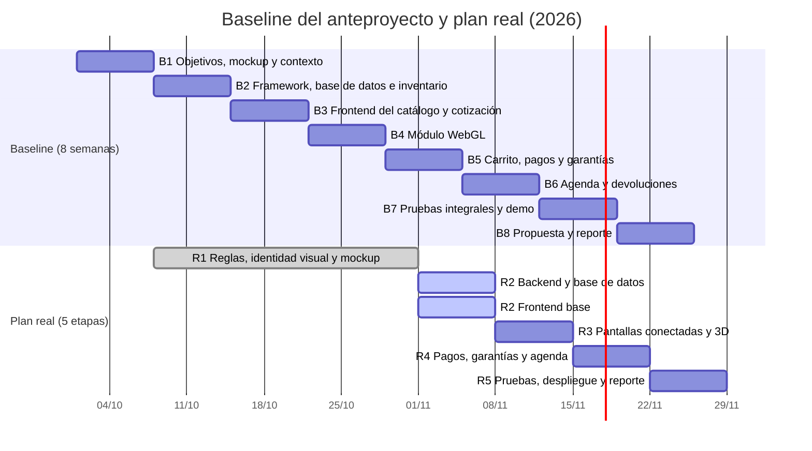

# Plan de trabajo: baseline y plan real

El anteproyecto del 1 de octubre de 2026 planeó 8 semanas. El plan real tiene 5 etapas: la Etapa 1 (8 al 31 de octubre) está completada y la Etapa 2 (1 al 7 de noviembre) está en curso. Este documento contrasta ambos planes, justifica el desfase y registra los cambios.

## Contenido

- [Baseline original](#baseline-original)
- [Justificación del desfase de la Etapa 1](#justificación-del-desfase-de-la-etapa-1)
- [Plan real en 5 etapas](#plan-real-en-5-etapas)
- [Gantt: baseline y plan real](#gantt-baseline-y-plan-real)
- [Correspondencia con las fases del prompt maestro](#correspondencia-con-las-fases-del-prompt-maestro)
- [Registro de cambios al plan](#registro-de-cambios-al-plan)
- [Riesgos](#riesgos)
- [Ver también](#ver-también)

## Baseline original

El anteproyecto se entregó el 1 de octubre de 2026 con un plan de 8 semanas lineales. La tabla da las fechas desde la entrega (1 de octubre) y desde el arranque técnico (8 de octubre), y el estado real al 1 de noviembre de 2026.

| Etapa (semana) | Fechas desde la entrega (1 oct) | Fechas desde el arranque (8 oct) | Actividad del anteproyecto | Resultado esperado | Estado real al 1 nov 2026 |
| --- | --- | --- | --- | --- | --- |
| 1 | 01 oct al 07 oct | 08 oct al 14 oct | Objetivos y requerimientos; mockup de la interfaz; arquitectura (diagrama de contexto) | Objetivos, requerimientos, mockup y diagrama de contexto definidos | Completada y ampliada (8 al 31 oct): reglas de negocio validadas con la pastelería, arquitectura con patrones, identidad visual y mockup de alta fidelidad de 60 vistas en escritorio y móvil. Es diseño, no código |
| 2 | 08 oct al 14 oct | 15 oct al 21 oct | Framework (selección, instalación, justificación); base de datos relacional; módulo de usuarios e inventario en tiempo real | Framework instalado, base de datos diseñada, módulo de usuarios e inventario desarrollado | En curso (Etapa 2 real). Django y React seleccionados y justificados; esqueleto de carpetas creado el 1 nov. Modelos ORM, repositorios y endpoints: por hacer |
| 3 | 15 oct al 21 oct | 22 oct al 28 oct | Frontend del catálogo; vista de precios; sistema para cotizar pedidos | Catálogo funcional con precios y cotización | Diseño terminado en el mockup; el código no existe. Se programa en la Etapa 3 real, conectado a la API |
| 4 | 22 oct al 28 oct | 29 oct al 04 nov | Módulo WebGL para personalizar y previsualizar en 3D obleas y decoraciones | Módulo WebGL funcional | Flujo visual y reglas del flujo "Diseña tu pastel" definidos; el lienzo 3D se programa en la Etapa 3 real |
| 5 | 29 oct al 04 nov | 05 nov al 11 nov | Carrito y pasarela de pagos; base de datos de los importes de bases ligados a cuentas | Pasarela integrada y garantías digitales ligadas a cuentas | Diseño de interfaz y reglas listos. Integración de pagos y garantías: Etapa 4 real |
| 6 | 05 nov al 11 nov | 12 nov al 18 nov | Agenda de entregas sin empalmes; cancelaciones y devoluciones | Agenda y cancelaciones funcionales | Reglas de capacidad, lapsos y anticipación definidas; código en la Etapa 4 real. La política de cancelaciones sigue pendiente de la pastelería |
| 7 | 12 nov al 18 nov | 19 nov al 25 nov | Pruebas integrales de compra e inventario; demo funcional | Sistema probado y demo preparado | Pendiente (Etapa 5 real). Se amplía con pruebas automatizadas y despliegue |
| 8 | 19 nov al 25 nov | 26 nov al 02 dic | Propuesta de negocio; reporte final; fuentes | Propuesta afinada, reporte y referencias | Pendiente (Etapa 5 real): cierre documental, comparativa baseline vs. real y referencias APA |

## Justificación del desfase de la Etapa 1

En el baseline, la semana 1 era un boceto rápido y la semana 2 pasaba a la base de datos. El equipo empezó el 8 de octubre y la Etapa 1 se alargó hasta el 31 de octubre por dos razones.

### Las reglas del negocio cambiaban con cada respuesta de la pastelería

Los flujos de "Diseña tu pastel", el préstamo de bases y la agenda sin empalmes tenían reglas complejas. La bitácora ([`../bitacora.md`](../bitacora.md)) muestra que esas reglas se fueron cerrando durante todo el mes:

- 26 de octubre: anticipación real de 2 días, paso de personas con mínimo de 4 kg y redondeo, relleno en dos niveles.
- 28 de octubre: horarios de la pastelería y de entrega, productos y precios reales, encargo de vitrina el mismo día, oblea de $125.
- 29 de octubre: anticipo del 50%, depósito de la base pagado completo y aparte, efectivo como pedido apartado, y creación de [`../reglas-de-negocio.md`](../reglas-de-negocio.md).
- 31 de octubre: bases y tarifa de envío aprobadas por la pastelería, y el envío se cobra completo y aparte del 50%.

Programar el esquema de PostgreSQL antes de esos cambios habría obligado a rehacer migraciones y modelos.

### La identidad visual se definió en la misma etapa

La pastelería real no tenía identidad visual. El 12 de octubre se fijó la dirección "Betún y duya" y el logo con la vela en la i; la paleta cambió dos veces (de jamaica a durazno el 12 de octubre y a "Fresa y mermelada" el 31 de octubre); y el libro de marca ([`../libro-de-marca.md`](../libro-de-marca.md)) quedó como documento rector visual. El 31 de octubre por la noche empezó el kit para construir el sitio, con 119 capturas de todas las vistas; quedó terminado el 1 de noviembre.

### Qué se adelantó y qué no

Se adelantó el diseño de las vistas, no el código. El mockup son prototipos HTML de un lienzo de diseño (`mockup/fuente/*.dc.html`): 120 tableros que equivalen a 60 vistas en escritorio y móvil, con estados de carga, error, vacío y agotado. No son componentes React y no abren solos, porque dependen de archivos del lienzo que no vienen en el repositorio.

La Etapa 1 absorbió así el diseño de las semanas 1, 3, 5 y 6 del baseline. A partir del 1 de noviembre, el backend cuenta con reglas y contratos de datos definidos, y el frontend tiene una referencia visual completa de cada pantalla. Como ese código no existe, el frontend arranca en la Etapa 2 junto con el backend (ver el [registro de cambios](#registro-de-cambios-al-plan)).

## Plan real en 5 etapas

| Etapa | Fechas | Estado | Entregables |
| --- | --- | --- | --- |
| 1. Levantamiento, identidad visual y diseño | 8 al 31 oct | Completada | Requerimientos y reglas de negocio validadas con la pastelería; identidad visual ("Betún y duya", paleta Fresa y mermelada, logo con la vela, dibujos de línea); libro de marca; mockup de alta fidelidad (60 vistas en escritorio y móvil, con estados); arquitectura y patrones |
| 2. Backend, base de datos y frontend base | 1 al 7 nov | En curso | Backend: proyecto Django y PostgreSQL, modelos ORM, repositorios, servicios de precio y garantías, DRF bajo `/api/v1/`, `drf-spectacular` en `/api/v1/docs/`, admin con precios y límites editables. Frontend base, en paralelo: React y Tailwind con el preset y las fuentes, componentes base del libro de marca, rutas de [`../mapa-de-vistas.md`](../mapa-de-vistas.md), página de muestra. Hoy: repositorio, `AGENTS.md` y documentación |
| 3. Pantallas conectadas e integración 3D | 8 al 14 nov | Por iniciar | Portada, catálogo, vitrina, rebanadas y ficha conectados a la API; acceso con Google y correo; "Diseña tu pastel" (8 pasos) con `react-three-fiber` y precio calculado por el backend (Strategy) |
| 4. Compra, pagos, garantías y agenda | 15 al 21 nov | Por iniciar | Carrito; entrega con agenda sin empalmes (lapsos de 30 min, máximo 3 pedidos por lapso, 2 días de anticipación); pago con Factory Method y Adapter, `Idempotency-Key` y webhooks idempotentes; Observer de eventos del pedido; garantías de bases (nota PDF con QR, `/nota/:token`, devolución registrada por el personal); envío de referencia y cotización; cancelaciones |
| 5. Pruebas, accesibilidad, despliegue y reporte | 22 al 28 nov | Por iniciar | `pytest` con `pytest-django` y Playwright; accesibilidad WCAG 2.1 AA; revisión de interfaz; despliegue en una PaaS; reporte final con baseline vs. real y referencias APA |

Las 8 etapas del baseline se consolidan así: la Etapa 2 real cubre la semana 2 y la base de datos de las semanas 5 y 6; la Etapa 3, las semanas 3 y 4; la Etapa 4, las semanas 5 y 6; la Etapa 5, las semanas 7 y 8.

## Gantt: baseline y plan real

Las barras del baseline son el plan y no llevan estado de avance; usan las fechas desde la entrega (1 de octubre). El plan real sí muestra el avance al 1 de noviembre de 2026.

## Correspondencia con las fases del prompt maestro

El prompt maestro con el que se encargó la construcción dividía el trabajo en 6 fases. Caen dentro de las 5 etapas así. La correspondencia es una previsión: el reparto de pantallas dentro de las etapas 3 y 4 se confirma al iniciarlas.

| Fase | Contenido | Etapa |
| --- | --- | --- |
| 1. Base | `frontend/` y `backend/`; componentes base del libro de marca; página de muestra | 2 |
| 2. Catálogo | Modelos de productos e inventario; admin de productos, precios y existencias; portada, catálogo, vitrina, rebanadas y ficha | 2 (modelos y admin) y 3 (pantallas) |
| 3. Cuenta y compra | Acceso con Google y correo; carrito; entrega con horarios y tarifa; pago en sandbox y efectivo; confirmación; "Mis pedidos"; detalle con bases | 3 (acceso) y 4 (el resto) |
| 4. Diseña tu pastel | Los 8 pasos con reglas validadas en el backend; precio calculado por el backend; vista previa 3D por etapas; revisión y paso al carrito | 3 (el paso al carrito se completa en la 4) |
| 5. Referencia y nota | Pedido con foto de referencia y cotización; nota en PDF con QR y su página de verificación; devolución de bases | 4 |
| 6. Cierre | Accesibilidad WCAG 2.1 AA; pruebas de la lógica de negocio; revisión de interfaz; lista de datos PENDIENTE | 5 |

## Registro de cambios al plan

| Fecha | Cambio | Motivo |
| --- | --- | --- |
| 1 nov 2026 | Se corrige la narrativa del mockup: son prototipos de diseño, no código React. El frontend arranca en la Etapa 2 y avanza en paralelo con el backend | La Etapa 1 adelantó el diseño de las vistas, no su programación. Esperar al backend para empezar el frontend dejaría las etapas 3 y 4 sin margen |
| 1 nov 2026 | La Etapa 2 pasa de "backend y base de datos" a "backend, base de datos y frontend base" | Consecuencia del cambio anterior |

## Riesgos

| Riesgo | Efecto posible | Mitigación |
| --- | --- | --- |
| Carga del frontend: 60 vistas con sus estados, 8 pasos de "Diseña tu pastel" y escena 3D, que ahora se construyen en el mismo periodo que el backend | Pantallas incompletas al cierre | Empezar por los componentes base y la página de muestra; construir cada pantalla contra sus capturas de escritorio y móvil; avanzar por etapas |
| Datos PENDIENTE de la pastelería: precio de las decoraciones fijas, repartidor propio o aplicación, vigencia de una cotización, políticas de cambios y cancelaciones, base dañada, dirección, WhatsApp, aviso de privacidad y términos | No se pueden cerrar el objetivo 6 ni los textos legales | Dejar cada dato configurable en la base de datos o el admin, con marcador PENDIENTE visible; nunca un valor supuesto |
| Integración de tres formas de pago (Mercado Pago, Stripe y efectivo) con cobros duplicados o webhooks repetidos | Cobros dobles o estados inconsistentes | Factory Method con registro y Adapter por SDK; `Idempotency-Key`; webhooks idempotentes; pruebas con SDK simulados |
| Fechas fijas: la Etapa 5 junta pruebas, accesibilidad, despliegue y reporte en una semana que termina el 28 de noviembre | Sin holgura para retrasos | Escribir pruebas desde las etapas 2 a 4 junto con el código; documentar al avanzar |
| Decisiones abiertas: versiones sin fijar, PaaS, API de distancias para la tarifa de envío | Retrasos al integrar | Fijar versiones al inicializar Django y React; ver [`tecnologias.md`](tecnologias.md#decisiones-abiertas) |

## Ver también

- [Objetivos y definición del producto](objetivos.md)
- [Arquitectura](arquitectura.md)
- [Decisiones](decisiones.md)
- [Bitácora del proyecto](../bitacora.md)
- [Reglas de negocio](../reglas-de-negocio.md)
